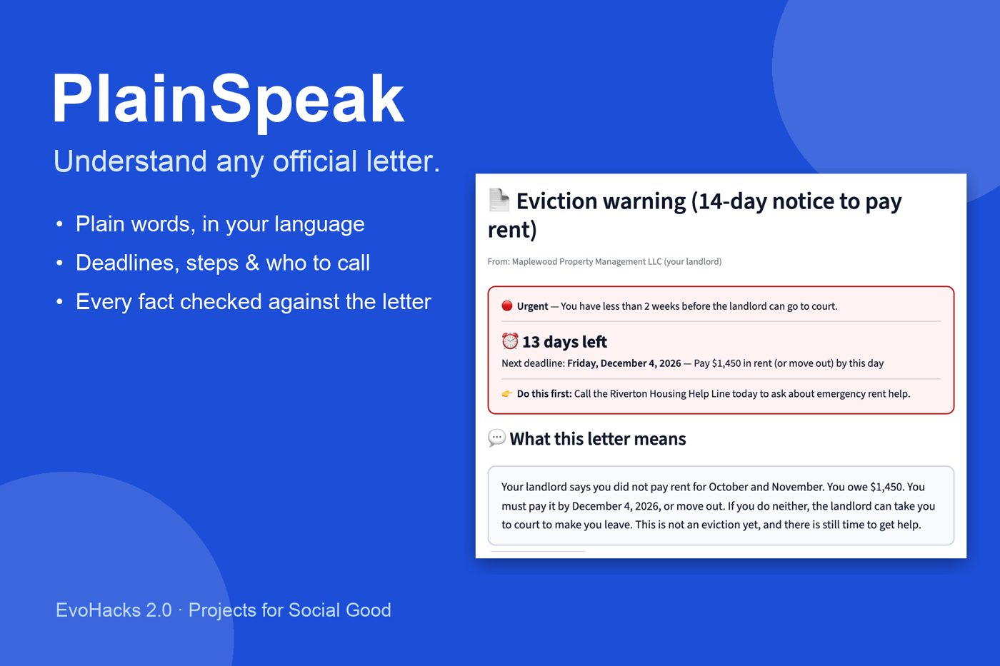
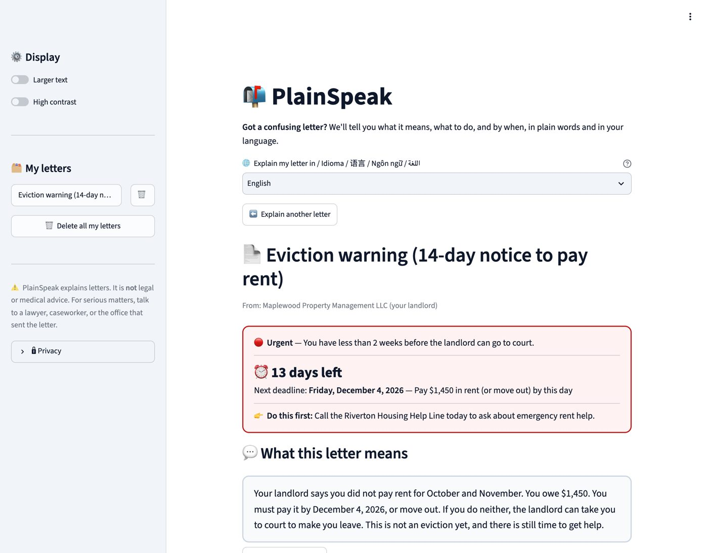
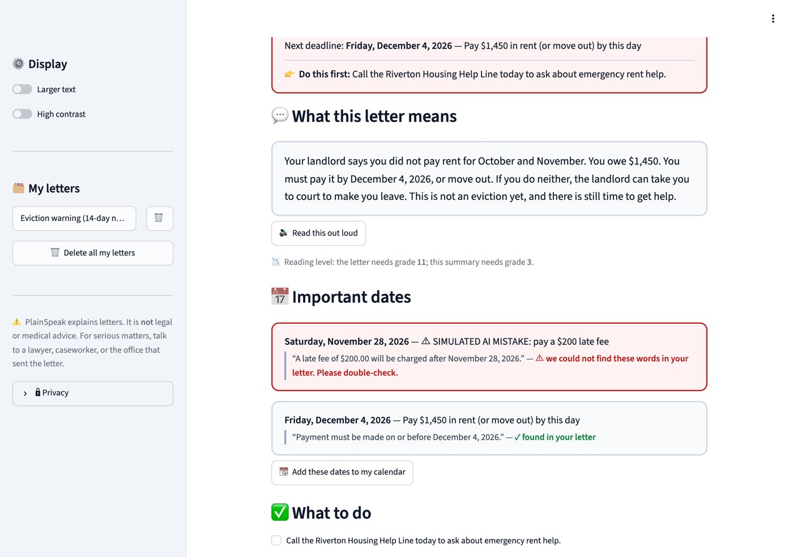
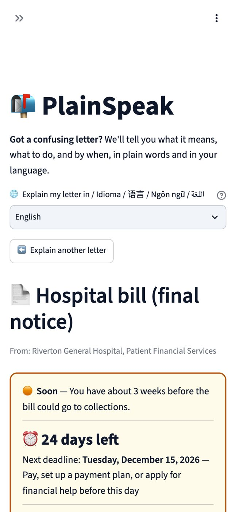

# 📬 PlainSpeak

**Take a photo of a confusing official letter. Find out what it means, what to do, and by when, in plain words and in your own language.**

Built at **EvoHacks 2.0** (theme: *Projects for Social Good*).



**Try it: https://plainspeak.streamlit.app** (no sign-up). Please use the examples or made-up details. See [Privacy](#privacy-and-security).

One-click examples: [eviction notice](https://plainspeak.streamlit.app/?example=eviction) · [in Spanish](https://plainspeak.streamlit.app/?example=eviction&lang=es) · [food benefits](https://plainspeak.streamlit.app/?example=benefits) · [hospital bill](https://plainspeak.streamlit.app/?example=hospital) · [watch it catch AI mistakes](https://plainspeak.streamlit.app/?example=eviction&mistake=1) · [high contrast + large text](https://plainspeak.streamlit.app/?example=benefits&contrast=1&bigtext=1)

| At a glance | Checking the AI's work | On a phone |
|---|---|---|
|  |  |  |

## The problem
Eviction notices, hospital bills and benefits renewals are written in legal language. People learning English, older people and people who struggle with reading often can't tell what a letter wants or how urgent it is. Missing a deadline can cost them their home, their benefits, or a bill sent to collections. Often the help they needed (rental assistance, a payment plan, how to reschedule) was in the same letter.

## What it does
- **Explains** the letter in 2–4 short sentences at about a 5th-grade reading level, in 11 languages, and can **read it aloud**. The whole app speaks the reader's language, not just the answer.
- **At a glance:** how urgent it is, a countdown to the next deadline ("13 days left"), and the first thing to do.
- **Lists** the deadlines (with an add-to-calendar file), the steps, the money, who to call, and the reader's rights as stated in the letter.
- **Answers questions** like "What if I can't pay?" using only the letter. If the letter doesn't say, it says so.
- **Points to people:** serious letters get "talk to a real person", and every answer shows 211 and LawHelp.org.
- **Writes a reply for you:** a short, polite letter asking for more time, a payment plan, a hearing, or an explanation. It uses only facts from the letter, puts what you must fill in inside [brackets], and warns you about any number, date, email or link that isn't in your letter.
- **What to bring:** a checklist of the papers the letter asks for (proof of income, ID, forms).
- **A private choice, and a backup:** "Don't send my letter to the AI" runs a basic check in plain Python that finds the dates, amounts and phone numbers in the letter's own words. The same check appears automatically if the AI is busy or out of free uses, so people are never left with nothing.
- **Share:** send a short summary by WhatsApp, text or email to a family member who helps, or print one.

## Checking the AI's work
AI can make things up, and a wrong date on an eviction notice is dangerous. So the AI has to **quote the letter** for every deadline, step and amount, and plain Python code (`plainspeak/checks.py`, no AI) checks it:
- **The quote is in the letter.** Small wording differences are allowed, but every *number* must match exactly. For pasted text we check against the text you pasted. For photos, there is no independent copy of the text, so we check against the AI's own reading of the photo, and the app says so ("found in what we read from your photo").
- **The date is written in the letter, in that sentence.** If the letter only says "within 14 days after service", the AI may calculate a date, but that depends on when you received it, so we never put it in the countdown or calendar. If the AI pairs a real sentence with a *different* date from elsewhere in the letter, it is flagged.
- **Phone numbers are only tap-to-call if they're in the letter.**
- **Urgency is checked against the calendar.** Our tests showed the AI calls a letter "urgent" even when its deadline is a month away: it isn't reliable at counting days. So the app tells the AI today's date, and plain code lowers "urgent" to "soon" when every verified deadline is more than 14 days away (eviction, court and immigration letters excepted). Exact urgency went from 76% to 94%.
- The 🧪 demo adds two fake mistakes (an invented deadline, and a real sentence with the wrong date) so you can watch the checks catch them.

## Testing
**Evaluation (`eval/`).** We wrote 30 fictional test letters modeled on real public templates (CFPB debt-collection model notice, CMS Medicaid notices, IRS balance-due notice, a state 14-day eviction notice, a court summons, a Section 8 termination notice, a foreclosure notice and more) and wrote the correct answers by hand. We ran PlainSpeak on them as pasted text, as used and stained phone photos, as blurry photos, as scanned PDFs, and in Spanish. Quotes and dates are scored against the *real* letter text. 11 of the letters were written after we wrote the prompt and kept apart as a held-out check. We wrote both the letters and the answers ourselves, so this is a careful self-test, not a study with real users.

| Results (51 runs on 30 letters) | |
|---|---|
| Deadlines found (right date, quote in the letter, date in that sentence) | **98%** (44/45) |
| Money amounts found | **100%** (31/31) |
| Quotes that are really in the original letter | **100%** (240/240) |
| Wrong dates the app would have shown as certain | **0** |
| Urgency: exact match with our answer (the AI alone: 78%) | **94%** (47/50) |
| "Talk to a real person" (letters where we set an answer) | **100%** (21/21) |
| Held-out letters: deadlines / money / exact urgency | 100% / 100% / 100% |
| Reading level of letter → summary (pasted English letters) | grade 9.7 → 4.9 |
| Median time per letter | about 3 s (text) to 4 s (photos and PDFs) |
| Safety cases: a letter that tries to trick the AI, a non-letter | both handled ✅ |

The main weak spots: on one stained photo where the deadline was cut off at the edge, the deadline was missed (the guessed date was flagged, not shown as certain), and a jury summons due in 13 days is called "urgent" where we would say "soon".

Full results, including everything it got wrong: [eval/RESULTS.md](eval/RESULTS.md).

**Other tests:**
- 188 automated tests (`pytest -q`), including the basic check, reply fact checks, the urgency calendar check, and a check that all 11 languages have every piece of text. They include feeding the page strange AI answers (empty, invalid dates, huge text, injected links and code, right-to-left text) and opening every example in all 11 languages.
- A full click-through of the live site in Chrome (`tests/e2e_site.py`). It covers all 11 languages on desktop and phone sizes (no sideways scrolling), the calendar and print downloads, share links, two visitors not seeing each other's letters, read-aloud, a live question, a trick letter, a non-letter, and keyboard-only navigation.
- Hard real-world letters through the live AI (`tests/hard_letters.py`): letters written in Chinese, Vietnamese and Russian, a court letter full of distracting dates, sideways, upside-down and dark photos, and a PDF with real text. All 8 get the right deadlines.
- Simulated failures (`tests/test_failures.py`): the AI busy, the limit reached, unreadable files, too many questions, and read-aloud down. Each gives a friendly message in the user's language, and pasted text is never lost.
- A browser test, `tests/e2e_uploads.py`, puts real files through the actual upload button. A phone photo, a scan, a PNG and a 2-page letter are explained. Six kinds of bad file (fake image, half-downloaded photo, giant image, too many pages) are refused with a clear message.
- An automated accessibility scan with axe-core, `tests/a11y_audit.py`, found 0 WCAG 2.1 AA violations on seven pages (English, Spanish, Arabic right-to-left, high contrast, and the basic check without AI). Automated scans catch only some issues. We haven't yet done a full screen-reader test.

## Privacy and security
- On the public site, **no letters are written to disk**. Saved letters live in your session in server memory and are gone when you close the page.
- The API key stays on the server.
- Uploads are checked (real image or PDF, size, total pages) on the server.
- Usage is rate-limited.
- AI text is escaped so a letter can't inject links or code into the page.
- **Limits:** this demo uses Gemini's *free* tier, where Google may use what you send to improve its products. We hide common ID numbers in *pasted* text only (best-effort, not photos). The app shows this warning above the upload button.

Details are in **[SECURITY.md](SECURITY.md)**.

## Tech
Python + Streamlit · Google Gemini API (structured JSON output, validated with Pydantic) · our own checks (`difflib`, regular expressions) · pypdf · Pillow · gTTS (read-aloud) · icalendar · Babel (dates in 11 languages) · textstat (reading level) · SQLite (local mode) · pytest, Playwright and axe-core (testing).

## Run it yourself
```bash
git clone https://github.com/KrypticStudios/plainspeak.git
cd plainspeak
python3.12 -m venv .venv && source .venv/bin/activate
pip install -r requirements.txt
cp .env.example .env    # paste a free key from https://aistudio.google.com into .env
streamlit run app.py
```
No key? The example letters still work. For testing, run `pip install -r requirements-dev.txt`, then `pytest -q`.

## How it's organized
```
app.py                     the web page
plainspeak/analyzer.py     sends the letter to Gemini, with our rules (the prompt)
plainspeak/schema.py       the exact shape the AI must answer in
plainspeak/checks.py       quote, date, phone, urgency and reply checks (no AI)
plainspeak/basic_reader.py basic check without AI: dates, amounts, phone numbers
plainspeak/privacy.py      ID hiding, upload checks, rate limits
plainspeak/export.py       countdown, printable summary, share message
plainspeak/ui_start.py, ui_text.py, ui_new.py   all text in 11 languages
eval/                      evaluation: answer key, scorer, results
tests/                     unit tests, browser upload test, accessibility scan
```

## Built at EvoHacks 2.0, and how we used AI
Everything here was built during the event (Nov 21–22, 2026). There was no code before it. All sample and test letters are fictional.

**Most of the code was written with Claude (Anthropic), an AI coding assistant**, directed by our team. We chose the problem and the users, decided how the app should behave (for example, never showing a calculated eviction date as certain, and putting the countdown first), wrote and checked the sample letters and answers, tested the app, and reviewed the code until we could explain it. The app itself uses Google Gemini to read letters.

PlainSpeak explains letters. It is not legal, medical or financial advice.
